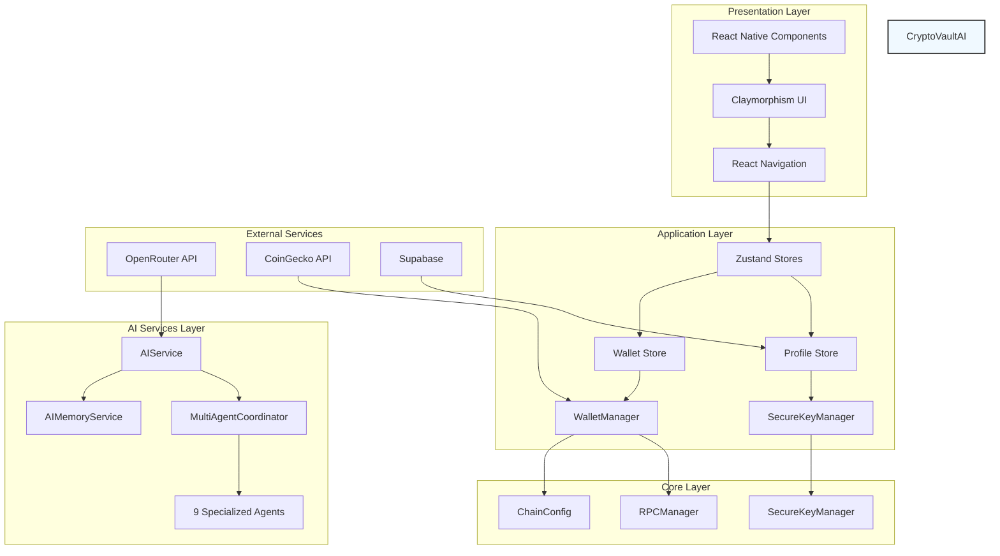

# CryptoVaultAI: AI-Powered Non-Custodial Crypto Wallet

## Certificate

This is to certify that the project report titled "CryptoVaultAI: AI-Powered Non-Custodial Crypto Wallet" has been successfully completed by the developer(s) in partial fulfillment of the requirements for the award of the degree. The project work has been carried out under our guidance and supervision. The project embodies original thought, systematic investigation, and technical rigor.

## Acknowledgement

The developer(s) wish to express deep sense of gratitude and indebtedness to all those who helped in the successful completion of this project. Special thanks to the open-source community for providing excellent libraries and tools that made this project possible. Gratitude is also extended to the Expo and React Native communities for their continuous support and documentation. The guidance provided by mentors and peers has been invaluable in shaping the direction and implementation of this project. Finally, sincere thanks to all users and contributors who provided feedback and feature requests that helped shape the evolution of CryptoVaultAI.

## Abstract

CryptoVaultAI is a decentralized, non-custodial cryptocurrency wallet mobile application built with React Native and Expo, designed to provide secure digital asset management while integrating artificial intelligence capabilities. The application supports 15+ EVM-compatible blockchains and Solana, enabling users to create, import, and manage wallets with biometric protection. CryptoVaultAI differentiates itself by incorporating AI-powered features throughout the user experience, including transaction explanation, portfolio analysis, risk assessment, scam detection, and AI chatbot assistance. The system leverages OpenRouter API with multiple large language models to provide personalized financial insights, educational content, and real-time market analysis. By combining traditional wallet functionality with advanced AI assistance, CryptoVaultAI aims to lower the barrier to entry for cryptocurrency users while maintaining the highest standards of security and privacy.

## Table of Contents

1. Title Page
2. Certificate
3. Acknowledgement
4. Abstract
5. Table of Contents
6. List of Figures
7. List of Tables
8. Introduction
9. Problem Statement
10. Existing System
11. Limitations of Existing System
12. Proposed System
13. Objectives
14. Scope of the Project
15. System Requirements
16. Hardware Requirements
17. Software Requirements
18. Technologies Used
19. System Architecture
20. Methodology
21. System Design

## List of Figures

*(To be populated with actual figures from the project)*

## List of Tables

*(To be populated with actual tables from the project)*

## Introduction

Cryptocurrency has revolutionized the financial landscape, offering decentralized, borderless, and trustless transactions. However, the widespread adoption of cryptocurrencies has been hindered by significant usability and security challenges. The management of private keys, recovery seed phrases, and the complexity of interacting with multiple blockchain networks present significant obstacles for average users. While numerous wallet solutions exist, most fall into two categories: custodial wallets that hold user private keys on their servers (introducing centralization risk) or non-custodial wallets that require users to manually manage their security credentials without any intelligent assistance. CryptoVaultAI addresses these challenges by proposing a non-custodial wallet framework integrated with artificial intelligence to enhance security, usability, and user education.

## Problem Statement

Despite the growing popularity of cryptocurrencies, several critical problems persist for users:

1. **Security Management**: Users must safely store and backup seed phrases, with permanent loss resulting in irreversible fund loss.
2. **Usability Barriers**: Complex blockchain interactions, gas fee management, and multi-chain support require technical expertise.
3. **Lack of Assistance**: Users have no intelligent guidance for transaction validation, risk assessment, or portfolio management.
4. **Educational Gap**: New users lack accessible resources to understand blockchain concepts, token functions, and safe practices.
5. **Multi-chain Fragmentation**: Managing assets across different blockchain networks requires separate interfaces or extensive technical knowledge.

Existing wallet solutions either compromise on security (custodial models) or usability (purely non-custodial models without intelligent assistance). There is a need for a solution that maintains self-custody while providing AI-driven support for security, education, and portfolio management.

## Existing System

The existing cryptocurrency wallet ecosystem includes several prominent solutions:

### 1. Custodial Wallets
- **Examples**: Exchange-integrated wallets (Binance, Coinbase Wallet)
- **Characteristics**: Private keys held by service provider; convenient access; counterparty risk
- **Limitations**: Users do not have full control over private keys; risk of platform insolvency or freeze

### 2. Non-Custodial Wallets
- **Examples**: MetaMask, Trust Wallet, Coinbase Wallet (standalone)
- **Characteristics**: User-controlled private keys; seed phrase backup; direct blockchain interaction
- **Limitations**: No intelligent assistance; users responsible for all security decisions; steep learning curve for DeFi interactions

### 3. Specialized Crypto Tools
- **Examples**: Block explorers, price tracking apps, DEX interfaces
- **Characteristics**: Focused on specific blockchain functions
- **Limitations**: Siloed functionality; no integrated wallet management; lack of unified experience

### 4. AI-Enhanced Crypto Projects
- **Examples**: Limited AI-assisted trading bots, analytics platforms
- **Characteristics**: AI for market analysis, price prediction, trading signals
- **Limitations**: Often require API keys; security concerns; limited to analysis rather than wallet management

None of the existing solutions combine non-custodial security with comprehensive AI assistance across wallet management, security education, portfolio analysis, and transaction explanation in a single unified interface.

## Limitations of Existing System

1. **Security Usability Gap**: Non-custodial wallets require users to manage complex seed phrases, leading to permanent fund loss if mishandled
2. **No Intelligent Security Assistance**: Users cannot receive real-time scam detection, risk assessment, or security guidance within their wallet interface
3. **Limited Educational Support**: No on-demand explanation of transactions, smart contracts, or blockchain concepts within the wallet experience
4. **Multi-chain Management Fragmentation**: Users need different interfaces or extensive knowledge to manage assets across multiple blockchains
5. **Portfolio Analysis Deficits**: Manual tracking of balances, performance, and asset allocation across chains is time-consuming and error-prone
6. **Transaction Validation**: Users cannot easily understand transaction details, gas fees, or potential risks before signing
7. **No Personalized Learning**: Existing wallets do not adapt to user behavior or provide personalized insights about usage patterns and preferences

## Proposed System

CryptoVaultAI proposes a novel approach by combining non-custodial wallet security with integrated artificial intelligence capabilities:

### Core Features:
1. **Biometric-Protected Non-Custodial Wallet**: Secure wallet creation and import with BIP39 mnemonic storage encrypted behind biometric authentication
2. **AI-Powered Transaction Explanation**: AI explains transaction details, destination addresses, gas fees, and potential risks in user-friendly language
3. **Portfolio AI Analysis**: Intelligent portfolio assessment, performance tracking, and asset allocation recommendations across supported chains
4. **Risk Assessment & Scam Detection**: Real-time analysis of destination addresses, smart contract interactions, and transaction patterns to warn of potential threats
5. **AI Chatbot Assistant**: Conversational interface for crypto education, answering questions, and guiding users through wallet operations
6. **Memory & Personalization**: AI learns user preferences (favorite chains, DEXs, risk tolerance, contacts) to provide contextual assistance
7. **Multi-chain Support**: Unified interface for 15+ EVM chains plus Solana asset monitoring
8. **Smart Swap & Trading Assistance**: AI-assisted token swapping with price impact analysis, slippage optimization, and timing recommendations

### Architecture:
The system employs a layered architecture with:
- **Secure Core**: Wallet management, key derivation, biometric protection
- **AI Services**: OpenRouter integration with model fallback and specialized agent coordination
- **Blockchain Integration**: RPC-based balance queries, transaction broadcasting across chains
- **Data Sync**: Optional Supabase integration for cross-device synchronization
- **User Interface**: Claymorphism-designed React Native components with responsive navigation

## Objectives

The primary objectives of the CryptoVaultAI project are:

1. **Develop a Secure Non-Custodial Wallet**: Create a wallet where users maintain full control of private keys with biometric-enhanced security
2. **Integrate AI Assistance**: Incorporate artificial intelligence to provide transaction explanation, risk analysis, and portfolio insights
3. **Support Multi-chain Asset Management**: Enable unified management of assets across 15+ EVM-compatible blockchains and Solana
4. **Enhance User Education**: Provide on-demand educational content and explanations about blockchain concepts and operations
5. **Implement Smart Risk Detection**: Develop AI-driven mechanisms to identify potential scams, risky transactions, and security threats
6. **Create Personalized User Experience**: Leverage AI memory services to learn user preferences and provide contextual assistance
7. **Ensure Cross-Platform Compatibility**: Deploy the application on iOS, Android, and web platforms using React Native and Expo
8. **Maintain Decentralization Principles**: Uphold non-custodial philosophy while integrating centralized AI services transparently

## Scope of the Project

The scope of CryptoVaultAI encompasses:

### Technical Scope:
- **Blockchain Networks**: Support for 15 EVM-compatible chains (Ethereum, BSC, Polygon, Base, Arbitrum, Avalanche, Optimism, Fantom, Cronos, and testnets) plus Solana
- **Wallet Functions**: Create, import, export, delete, and backup wallets with BIP39 mnemonic support
- **Transaction Operations**: Send, receive, and swap tokens across supported chains
- **AI Integration**: OpenRouter API integration with multiple LLM models and specialized agent coordination
- **Storage Solutions**: Expo Secure Store for mnemonic encryption, AsyncStorage for user preferences

### Functional Scope:
- Real-time balance tracking with USD valuation
- QR code-based address sharing
- Floating bottom navigation with 5 main tabs
- Onboarding flow for new users
- App locking mechanism with biometric authentication
- AI chatbot with streaming responses
- Portfolio overview with performance metrics
- Market data integration via CoinGecko

### Excluded Scope:
- Direct fiat-to-crypto purchase (handled via third-on-ramps)
- Node operation or validator participation
- L1 blockchain development or consensus mechanism design
- Creation of new cryptocurrency tokens
- Regulatory compliance consulting

## System Requirements

### Functional Requirements:
1. **Wallet Creation**: Support for generating new BIP39 mnemonic seed phrases
2. **Wallet Import**: Validation and import of existing seed phrases
3. **Biometric Authentication**: Face ID/Touch ID or PIN-based app locking
4. **Multi-chain Balance Query**: Real-time balance retrieval for all supported chains
5. **Token Transfer**: Send functionality with gas fee estimation and validation
6. **Token Reception**: Receive addresses with QR code generation
7. **Token Swap**: Smart swap functionality with price impact analysis
8. **AI Chat**: Conversational interface with streaming responses
9. **Portfolio Overview**: Visual representation of asset distribution and values
10. **Risk Analysis**: AI-powered scam detection and transaction risk assessment

### Non-Functional Requirements:
1. **Security**: Private keys never leave device; mnemonics encrypted with biometric protection
2. **Performance**: Balance queries under 2 seconds; AI responses under 5 seconds
3. **Reliability**: 99.9% uptime for API services; graceful degradation for offline mode
4. **Usability**: Intuitive interface requiring minimal blockchain knowledge
5. **Compatibility**: iOS 14+/Android 8+/Web browsers support
6. **Privacy**: No user data transmitted without explicit consent; optional Supabase sync

## Hardware Requirements

- **Mobile Devices**: 
  - iPhone 8 or newer (iOS 14+)
  - Android devices with 3GB RAM or higher (Android 8+)
  - Minimum screen resolution: 720p (1280x720)

- **Development Environment**:
  - CPU: 2+ GHz processor recommended
  - RAM: 4GB minimum for development and testing
  - Storage: 2GB available space for development environment

- **Peripherals**:
  - Camera: For QR code scanning (receive functionality)
  - Biometric sensors: Face ID or Touch ID for app locking (optional, fallback to PIN)
  - Network: Stable internet connection for blockchain RPC calls and AI services

## Software Requirements

### Operating Systems:
- iOS 14.0 or later
- Android 8.0 (Oreo) or later
- Web browsers: Chrome 80+, Firefox 75+, Safari 14+

### Dependencies and Libraries:
- **React Native**: 0.86.2
- **Expo**: 57.0.10
- **TypeScript**: 5.7+ (strict mode)
- **React Navigation**: 6.x+
- **Zustand**: 5.x+ (state management)
- **Expo Secure Store**: For encrypted mnemonic storage
- **Async Storage**: For user preferences and settings
- **Ethers.js**: 6.x+ (EVM blockchain interaction)
- **Expo Local Authentication**: For biometric verification
- **React Native Paper**: UI component library
- **OpenRouter API**: AI service integration
- **CoinGecko API**: Market data and price tracking
- **BIP39 & BIP32**: Mnemonic and derivation path standards

### Development Tools:
- Node.js: 18.0 or later
- npm or yarn: Package management
- Xcode: iOS development (version 15.0+)
- Android Studio: Android development (version 2023.2.1+)
- Visual Studio Code: Recommended code editor

## Technologies Used

### Framework and Language:
- **React Native**: 0.86.2 - Cross-platform mobile framework
- **Expo**: 57.0.10 - Development platform and SDK
- **TypeScript**: 5.7+ - Typed JavaScript for robust development

### State Management:
- **Zustand**: 5.x+ - Lightweight state management with persistence
- **React Context API**: Theme and authentication state management

### Blockchain and Crypto:
- **ethers.js**: 6.x - EVM blockchain interaction library
- **BIP39**: Mnemonic sentence generation and validation
- **BIP32**: Hierarchical deterministic wallet derivation
- **ChainConfig**: Custom chain configurations for 15+ EVM networks + Solana

### AI and Machine Learning:
- **OpenRouter API**: Aggregated LLM access with 30+ free-tier models
- **Model Fallback Chain**: Intelligent model selection and fallback strategies
- **Multi-Agent Coordination**: 9 specialized AI agents for different domains
- **AIMemoryService**: User preference learning and behavior analysis

### UI and Design:
- **React Native Paper**: Material Design components
- **Custom Claymorphism**: Unique design system with soft shadows, gradients, and rounded corners
- **Theme System**: Light/dark mode with system synchronization
- **Icon System**: Theme-aware vector icons

### APIs and Services:
- **CoinGecko API**: Cryptocurrency price data, market caps, volume tracking
- **OpenRouter API**: AI model routing and chat completions
- **Supabase**: Optional backend for cloud sync and user preferences
- **RPC Providers**: Alchemy premium URLs with public fallback networks

### Development Infrastructure:
- **Git**: Version control
- **npm**: Package manager
- **PowerShell/Bash**: Build and automation scripts
- **Expo CLI**: Development server and build tools

## System Architecture



### Detailed Component Description:

1. **Presentation Layer**: React Native UI components styled with Claymorphism design language, handled by React Navigation for intuitive navigation flow (bottom tabs + native stack)

2. **Application Layer**: Zustand stores manage global state including wallet state (balances, transactions, network selection) and user profile (onboarding status, sign-in state, preferences)

3. **Core Layer**: 
   - `WalletManager`: Orchestrates transaction creation, signing, and broadcasting across multiple chains
   - `RPCManager`: Multi-chain JSON-RPC provider management with caching and balance querying
   - `ChainConfig`: Comprehensive configuration for 15 EVM chains including RPC URLs, token symbols, and decimal configurations
   - `SecureKeyManager`: Biometric-protected mnemonic storage, wallet creation/import, and signature signing

4. **AI Services Layer**:
   - `AIService`: OpenRouter API integration with model selector, auto-fallback, and streaming chat support
   - `AIMemoryService`: Learns user preferences from interaction events (favorite chains, preferred DEXs, risk level, contacts)
   - `MultiAgentCoordinator`: Coordinates 9 specialized agents (Research, Security, Portfolio, Trading, Tax, Wallet, NFT, DeFi, Governance)

5. **External Services**:
   - **OpenRouter API**: Provides access to multiple large language models for chat, analysis, and generation tasks
   - **CoinGecko API**: Real-time cryptocurrency pricing, market data, and historical analytics
   - **Supabase**: Optional cloud synchronization for user preferences and wallet state across devices

### Data Flow:
- User initiates transaction → WalletStore → WalletManager → RPCManager → Blockchain → Response
- User asks AI question → AIService → MultiAgentCoordinator → Specialized Agents → Synthesis → Streaming response
- Biometric auth request → Expo Local Authentication → SecureKeyManager → Biometric validation → Wallet access

## Methodology

### Development Methodology:
The CryptoVaultAI project follows an **Agile Scrum methodology** with iterative development cycles. The project is structured into sprints focusing on incremental feature delivery, continuous integration, and regular feedback integration.

### Phases:

#### 1. Requirements & Planning Phase
- Stakeholder analysis and requirement gathering
- Technical feasibility assessment for AI integration and multi-chain support
- Definition of MVP feature set and stretch goals
- Technology stack selection and architecture design

#### 2. Design Phase
- **UI/UX Design**: Wireframing and prototyping with Claymorphism design principles
- **Information Architecture**: Navigation flow design (onboarding → lock → main app)
- **Database Design**: AsyncStorage key structure and SecureStore encryption schema
- **AI Architecture**: Model selection, fallback strategy, and agent coordination design

#### 3. Implementation Phase
- **Sprint 1**: Core wallet functionality (create/import wallet, biometric lock, basic balances)
- **Sprint 2**: Multi-chain support expansion (EVM chains + Solana display)
- **Sprint 3**: AI integration (basic chat functionality, model fallback)
- **Sprint 4**: AI agent coordination (portfolio analysis, risk assessment)
- **Sprint 5**: User experience refinements (onboarding, theming, QR code functionality)
- **Sprint 6**: Testing, optimization, and release preparation

#### 4. Testing Phase
- **Unit Tests**: Individual component and function testing
- **Integration Tests**: Wallet flow, AI service integration, multi-chain interactions
- **UI Tests**: Navigation, theming, responsive design across devices
- **Security Tests**: Biometric authentication flow, encrypted storage validation
- **Performance Tests**: Balance query latency, AI response time, memory usage

#### 5. Deployment Phase
- **Expo Application Services**: Build configuration for iOS and Android
- **App Store Submission**: Compliance with platform guidelines
- **CDN Configuration**: Asset delivery and caching
- **Monitoring Setup**: Error tracking and performance monitoring

### Research Methodology:
- **Literature Review**: Analysis of existing cryptocurrency wallet architectures and AI integration patterns
- **Benchmark Testing**: Performance comparison against existing wallets (MetaMask, Trust Wallet)
- **User Testing**: Usability studies with target audience for feedback incorporation
- **AI Model Evaluation**: Testing multiple LLM providers through OpenRouter for optimal performance/cost balance

### Security Methodology:
- **Zero-Knowledge Principle**: Private keys never transmitted or stored on servers
- **Biometric Encryption**: Mnemonic phrases encrypted with platform biometric keys
- **Secure Enclave Utilization**: Leveraging device-specific secure storage
- **Error Handling**: Graceful failure modes that never expose sensitive data
- **Audit Logging**: Optional, user-consented activity logging for troubleshooting

## System Design

### 1. Overall System Design

CryptoVaultAI employs a **client-first architecture** where the mobile device serves as the primary authority for wallet operations and security critical functions. The system is designed with separation of concerns between UI, business logic, blockchain interaction, and AI services.

### 2. Component Design

#### A. Wallet Management Design

**Wallet Creation Process:**
```
Step 1: User selects "Create Wallet"
Step 2: BIP39 mnemonic generation (12/24 words)
Step 3: mnemonic entropy validation
Step 4: Ethereum wallet derivation via BIP32 (m/44'/60'/0'/0/0)
Step 5: mnemonic encryption with biometric key (Expo Secure Store)
Step 6: Wallet address display and QR code generation
Step 7: Onboarding completion and profile storage
```

**Wallet Import Process:**
```
Step 1: User selects "Import Wallet"
Step 2: Mnemonic phrase input (12/24 words)
Step 3: Validation against BIP39 standards
Step 4: Derivation of master seed and child wallets
Step 5: Encryption and secure storage
Step 6: Biometric authentication setup
Step 7: Immediate wallet accessibility
```

#### B. AI Integration Design

**Chat Flow:**
```
User Query → AIService (OpenRouter) → Model Selection → 
MultiAgentCoordinator → Agent Dispatch → 
Specialized Processing → Response Synthesis → Streaming Output
```

**Memory Learning Loop:**
```
User Interaction → Event Recording → Pattern Analysis → 
Preference Update → Contextual Suggestions → Enhanced UX
```

#### C. Navigation Design

**Flow Hierarchy:**
```
App Launch
  │
  ├─ isSignedIn = false → Onboarding Flow
  │   └─ Welcome → Email/OTP → Name → Profile → Wallet Setup → Main App
  │
  ├─ isSignedIn = true, wallet exists, backgrounded → Biometric Lock
  │   └─ Authentication → Main App (if successful) or Login Failed
  │
  └─ isSignedIn = true, wallet exists, foreground → Main App Navigation
      └─ Bottom Tabs: Explore/Wallet, Wallet, Market/Swap, Academy, Profile
```

#### D. Data Design

**Storage Structure:**
- **AsyncStorage Keys**:
  - `onboardingCompleted` (boolean)
  - `userProfile` (object: name, email, preferences)
  - `appLockStatus` (biometric/PIN configuration)
  
- **Expo Secure Store**:
  - `mnemonic` (encrypted seed phrase)
  - `walletAddress` (derived, non-sensitive)
  - `biometricAuthState` (authentication status)

- **Zustand Stores**:
  - `walletStore`: balances, transactions, network selection, chain state
  - `profileStore`: user preferences, onboarding state, sign-in status

#### E. AI Agent Design

**Nine Specialized Agents:**
1. **Research Agent**: Market research, coin analysis, blockchain explanations
2. **Security Agent**: Scam detection, address validation, risk assessment
3. **Portfolio Agent**: Performance tracking, asset allocation, rebalancing suggestions
4. **Trading Agent**: Trade execution assistance, gas optimization, timing analysis
5. **Tax Agent**: Capital gains calculation, transaction categorization, compliance guidance
6. **Wallet Agent**: Wallet operations guidance, feature explanations, troubleshooting
7. **NFT Agent**: NFT collection analysis, rarity assessment, marketplace guidance
8. **DeFi Agent**: Protocol analysis, yield farming opportunities, risk evaluation
9. **Governance Agent**: voting mechanisms, proposal analysis, protocol updates

### 3. Security Design

**Biometric Protection Flow:**
```
User Attempts App Access
  │
  ├─ Check biometric enrollment status
  │   ├─ Enrolled → Request authentication (expo-local-authentication)
  │   │   ├─ Success → Unlock SecureStore → Grant wallet access
  │   │   └─ Failure → Retry or fallback to PIN
  │   └─ Not Enrolled → Prompt enrollment or use PIN fallback
  │
  └─ Not Biometrically Enrolled → PIN authentication fallback
```

**Encryption Standards:**
- Mnemonic phrases encrypted using AES-256 with biometric-derived key
- No plaintext secrets stored in AsyncStorage or transmitted externally
- All RPC communications over HTTPS
- No logging of private key material in any form

### 4. User Interface Design

**Claymorphism Design System:**
- **Visual Style**: Soft shadows, frosted glass effects, layered elements
- **Color Palettes**: 
  - Light mode: Soft gradients from #F8FAFC to #E2E8F0
  - Dark mode: Deep gradients from #0F0F23 to #1E293B
- **Typography**: System font scaling with proper hierarchy (H1-H6, body, caption)
- **Spacing**: 8-point scale system (4px, 8px, 16px, 24px, 32px)
- **Border Radius**: 16px primary, 8px secondary, 4px micro

**Component Library:**
- `ClayButton`: Primary/secondary variants with hover/shadow effects
- `Card`: Claymorphism-styled container with customizable shadow
- `Chip`: Token symbol display with chain color coding
- `FloatingBottomNav`: 5-tab navigation with active/inactive states
- `QRCodeView`: Scannable address display with copy functionality
- `CandlestickChart`: Technical analysis visualization
- `RealtimeLineChart`: Portfolio performance chart

### 5. Error Handling Design

**Graceful Degradation:**
- Offline mode: Local balances cached, AI features disabled
- API failures: Automatic fallback to public RPC endpoints
- Biometric failure: PIN fallback with clear error messaging
- Transaction failures: User-friendly error codes and retry options

**Logging & Monitoring:**
- Anonymous error tracking (opt-in)
- Performance metrics collection
- AI response quality assessment
- No sensitive data in logs

---